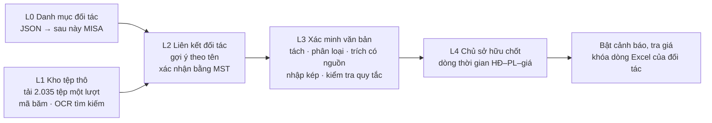
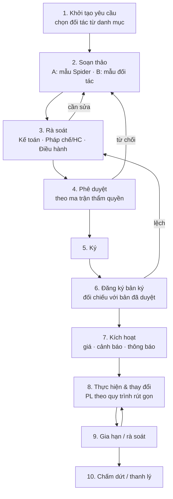
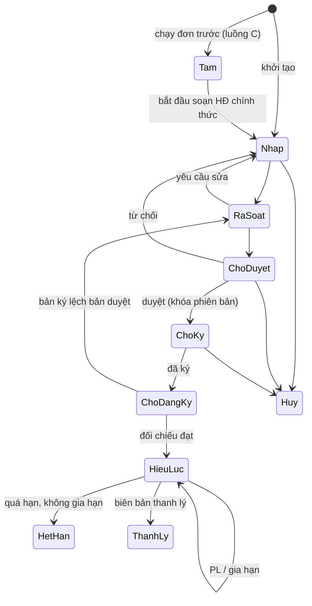

# Phương án tối ưu: Số hóa hợp đồng hiện hữu & Quy trình hợp đồng mới

| Mục         | Nội dung                                                                                             |
| ----------- | ---------------------------------------------------------------------------------------------------- |
| Dự án       | Hệ thống Quản lý Vòng đời Hợp đồng (Spider CLM – SCLM)                                               |
| Mã tài liệu | SCLM-PA-10                                                                                           |
| Phiên bản   | 1.0 – bản đề xuất                                                                                    |
| Ngày        | 23/11/2026                                                                                           |
| Liên quan   | 01 BRD · 02 SRS · 03 Kế hoạch số hóa · 08 Kiểm kê & ước lượng · 09 Phương án số hóa theo KH mục tiêu |

---

## 0. Tóm tắt

Hai mục tiêu, giải bằng **một nền tảng dữ liệu chung**:

| #   | Mục tiêu                                                                                                | Câu trả lời ngắn                                                                                                                                                                                                                              |
| --- | ------------------------------------------------------------------------------------------------------- | --------------------------------------------------------------------------------------------------------------------------------------------------------------------------------------------------------------------------------------------- |
| 1   | Số hóa **toàn bộ HĐ và PL hiện có** theo khách hàng mục tiêu, để tra cứu đơn, cảnh báo và bỏ được Excel | **Khả thi, nhưng không làm một lượt.** Tải toàn bộ tệp lên một lượt để lưu trữ và tìm kiếm. Xác minh và đưa vào vận hành **theo làn sóng đối tác**: mỗi lần làm trọn hồ sơ của một đối tác, chủ sở hữu chốt xong mới bật cảnh báo và tra giá. |
| 2   | Có **quy trình chuẩn** đưa một HĐ mới vào hệ thống khi phát sinh                                        | Một quy trình 10 bước với 3 luồng vào: HĐ theo mẫu Spider, HĐ theo mẫu đối tác, và chạy đơn trước khi có HĐ. **Bản đăng ký HĐ mới phải chạy trước tiên**, ngay từ pilot, để kho hồ sơ chưa số hóa không phình thêm trong lúc đang số hóa.     |

Thứ tự tối ưu: **nền tảng → đăng ký HĐ mới (chặn nợ mới) → pilot số hóa → các làn sóng → quy trình soạn–duyệt–ký đầy đủ → đóng Excel.**

"Chính xác tuyệt đối, không suy đoán" được biến thành 4 cam kết mà hệ thống tự kiểm tra được (mục 2).

---

## 1. Phạm vi

**Trong phạm vi**

- HĐ khách hàng, HĐ nhà cung cấp (nhà thầu), HĐ thuê kho hai chiều, cùng toàn bộ phụ lục (PL), báo giá, biên bản gia hạn và thanh lý.
- Danh mục đối tác: hiện lấy từ `data/*.json`; sau này đồng bộ từ MISA.
- **Tra cứu đơn:** với một đơn hàng (đối tác, tuyến hoặc khu vực, loại xe, ngày), tra ra HĐ/PL đang áp dụng, giá áp dụng và căn cứ.
- **Cảnh báo:** sắp hết hạn, đến kỳ rà soát HĐ tự gia hạn, giá dầu vượt ngưỡng, thiếu PL, đơn phát sinh khi chưa có HĐ.

**Ngoài phạm vi:** chứng từ thực hiện HĐ (đơn, hóa đơn, biên bản giao nhận). Riêng một số hóa đơn được dùng để đối soát giá.

---

## 2. Nguyên tắc chung cho cả hai mục tiêu

### 2.1 Bốn cam kết "chính xác tuyệt đối, không suy đoán"

| Cam kết                                    | Nội dung                                                                                                                                | Hệ thống thực thi                                                                                             |
| ------------------------------------------ | --------------------------------------------------------------------------------------------------------------------------------------- | ------------------------------------------------------------------------------------------------------------- |
| **C1. Có nguồn**                           | Mỗi giá trị nghiệp vụ trỏ tới văn bản, trang và trích dẫn nguyên văn.                                                                   | Trường không có nguồn thì không chuyển được sang "đã xác minh".                                               |
| **C2. Một người, đối chiếu rồi công bố**   | Người số hóa nhập và tự đối chiếu với bản scan; bấm **Công bố** là lời xác nhận. Không bắt người thứ hai duyệt (quyết định 25/11/2026). | Không công bố được khi còn thiếu dữ kiện bắt buộc; mọi lần sửa sau công bố phải có lý do và được lưu lịch sử. |
| **C3. Không biết thì ghi là không biết**   | Dùng giá trị đặc biệt: _Không ghi trong văn bản_, _Không đọc được_, _Văn bản thiếu_.                                                    | Không cho để trống trường bắt buộc; không có giá trị mặc định đoán sẵn.                                       |
| **C4. Chỉ hành động trên dữ liệu đã chốt** | Cảnh báo, tra giá và báo cáo chỉ dùng dữ liệu đã chốt.                                                                                  | Đối tác chưa chốt thì trả "chưa số hóa – xem tệp gốc", không trả một con số.                                  |

Giá trị suy ra (trạng thái HĐ, hạn hiện hành, giá hiện hành) chỉ được tính bằng **quy tắc xác định** từ dữ liệu đã chốt, và luôn kèm giải thích. Ví dụ: _"Đã chấm dứt 25/03/2025 – theo Biên bản thanh lý, Điều 1.1"_.

### 2.2 Các nguyên tắc khác

1. **Văn bản ký là chuẩn.** Có hai lớp dữ liệu: bản ký bất biến (mã băm SHA-256, không sửa, không xóa) và dữ liệu nghiệp vụ có cấu trúc trỏ về bản ký. Khi Excel, TMS hoặc lời kể mâu thuẫn với văn bản ký, văn bản ký thắng; mâu thuẫn được ghi lại.
2. **Đối tác thuộc danh mục nguồn.** CLM không tự tạo đối tác từ tên thư mục hay tên trong HĐ. Đối tác mới được tạo ở danh mục nguồn (hiện là tệp dữ liệu, sau này là MISA) rồi đồng bộ về. Khóa ghép là **MST**, không phải tên.
3. **Đơn vị hoàn thành là hồ sơ đối tác:** toàn bộ HĐ, PL và giá của một đối tác. Số hóa nửa chuỗi PL thì giá hiện hành tính ra sẽ sai.
4. **AI chỉ đề xuất, con người quyết định.** OCR/AI dùng để tìm kiếm và điền sẵn; không tự duyệt.

---

## 3. Mục tiêu 1 – Số hóa hồ sơ hiện hữu theo khách hàng mục tiêu

### 3.1 Hiện trạng (đo trên dữ liệu thật, 23/11/2026)

| Chỉ số                                              | Kết quả                                                                                              |
| --------------------------------------------------- | ---------------------------------------------------------------------------------------------------- |
| Quy mô                                              | 958 bộ hồ sơ (594 KH, 364 NCC), 2.035 tệp, 1.959 PDF                                                 |
| PDF có lớp chữ                                      | khoảng 8%; khoảng 92% là bản scan                                                                    |
| Chất lượng scan (đọc trọn hồ sơ MASAN NĐ, 40 trang) | Chữ in rõ, đọc được toàn bộ; dấu đỏ đè lên chữ ở mép trang                                           |
| Ghép theo tên thư mục – KH                          | 62% khớp duy nhất · 10% khớp gần đúng · 4% nhiều ứng viên · 23% không khớp                           |
| Ghép theo tên thư mục – NCC                         | 59% · 5% · 6% · 30%                                                                                  |
| MST trong danh mục                                  | KH 866/1.000 · NCC **18/963**                                                                        |
| Sổ Excel                                            | 601/1.201 dòng HĐ KH không xác định được hiệu lực; 413 dòng KH và 279 dòng NCC ghi "tự động gia hạn" |

Riêng hồ sơ MASAN NĐ (1 HĐ, 12 PL, 1 biên bản thanh lý) đã cho thấy các vấn đề Excel không bắt được:

- **Sổ sai so với văn bản:** sổ ghi gia hạn đến 30/06/2025, nhưng biên bản thanh lý chấm dứt HĐ từ 25/03/2025.
- **Tiêu đề không khớp nội dung:** PL05 có căn cứ "biến động giá dầu" nhưng chỉ gia hạn HĐ.
- **Một PL sửa nhiều thứ:** PL12 sửa cùng lúc bảng giá, tham số giá dầu (giá cơ sở 17.890 đ/lít, D = 35%, ngưỡng ±10% lũy kế, hiệu lực từ ngày thứ 11) và địa chỉ Bên B.
- **Đánh số trang lạ:** tệp PL04 đánh số trang 3–8.
- **Biên bản không số:** biên bản thanh lý để trống số văn bản.
- **Chưa rõ HĐ thay thế** sau khi thanh lý.

### 3.2 Vì sao không đưa toàn bộ lên trong một lượt

| Lý do                               | Giải thích                                                                                                          |
| ----------------------------------- | ------------------------------------------------------------------------------------------------------------------- |
| Khối lượng xác minh                 | Khoảng 114 ngày công, đã gồm 25% dự phòng (tệp 08). Xác minh không tự động hóa được mà vẫn giữ cam kết C2.          |
| Dữ liệu chưa xác minh gây hại       | Cảnh báo sai trong tuần đầu (ví dụ báo MASAN NĐ "sắp hết hạn" trong khi đã thanh lý) làm người dùng quay lại Excel. |
| Mâu thuẫn cần người nghiệp vụ quyết | Hàng trăm câu hỏi dồn cùng lúc sẽ làm tắc Kinh doanh và QL NCC.                                                     |
| Danh mục chưa sạch                  | 23–30% hồ sơ chưa ghép được đối tác; NCC gần như không có MST.                                                      |

### 3.3 Phương án: tải thô một lượt → xác minh theo làn sóng → chốt từng đối tác

| Lớp                     | Phạm vi           | Ai                                         | Dữ liệu dùng được cho                          |
| ----------------------- | ----------------- | ------------------------------------------ | ---------------------------------------------- |
| L0 Danh mục             | Toàn bộ, một lượt | IT (tự động)                               | Ghép đối tác                                   |
| L1 Kho tệp thô          | Toàn bộ, một lượt | Hệ thống                                   | Tìm kiếm tham khảo, gắn nhãn **chưa xác minh** |
| L2 Liên kết đối tác     | Theo làn sóng     | Nhân sự số hóa                             | Hàng đợi xác minh                              |
| L3 Đối chiếu và công bố | Theo làn sóng     | Nhân sự số hóa (một người nhập và công bố) | Đối soát, công bố                              |
| L4 Chốt                 | Từng đối tác      | Kinh doanh / QL NCC                        | **Cảnh báo, tra giá, báo cáo**                 |

**Làn sóng**

| Làn sóng             | Phạm vi                                                                            | Mức số hóa                                       | Điều kiện qua làn sóng                                                             |
| -------------------- | ---------------------------------------------------------------------------------- | ------------------------------------------------ | ---------------------------------------------------------------------------------- |
| W0 Nền tảng          | L0 + L1 toàn bộ                                                                    | Lưu trữ + tìm kiếm                               | 2.035 tệp tìm được; danh mục nhập xong, có báo cáo chất lượng                      |
| W1 Pilot             | 5 đối tác: 1 KH nhiều PL (như MASAN), 1 KH thuê kho, 1 NCC có giá dầu, 2 KH thường | Đầy đủ, gồm bảng giá có cấu trúc                 | 5 đối tác được chốt; định mức phút/văn bản đo thật thay cho ước lượng trong tệp 08 |
| W2 Chiến lược        | Top KH và NCC theo điểm (mục 3.4)                                                  | Đầy đủ, gồm bảng giá                             | 100% đối tác được chốt, hoặc ghi "đặc thù" kèm lý do                               |
| W3 Hoạt động còn lại | Đối tác có HĐ còn hiệu lực hoặc tự gia hạn                                         | Định danh + hiệu lực + PL + điều khoản then chốt | Như trên, rồi **đóng sổ Excel**                                                    |
| W4 Lưu trữ           | HĐ hết hạn hoặc đã thanh lý                                                        | Định danh + ngày + trạng thái                    | Làm song song khi có nhân lực rảnh                                                 |

**Quy tắc "kéo lên trước":** nếu một đối tác **chưa số hóa** phát sinh PL mới, gia hạn hoặc thanh lý, hồ sơ của đối tác đó được đưa lên đầu hàng đợi. Lý do: không thể đăng ký PL cho một HĐ chưa có trên hệ thống. Đây là cầu nối giữa mục tiêu 1 và mục tiêu 2.

### 3.4 Chọn khách hàng mục tiêu

Danh sách do Kinh doanh và QL NCC đề xuất, Ban Giám đốc duyệt. BA không tự chọn. Trọng số đề xuất để xếp thứ tự:

| Tiêu chí                                  | Trọng số | Nguồn                                |
| ----------------------------------------- | -------- | ------------------------------------ |
| Doanh thu hoặc chi phí 12 tháng gần nhất  | 40%      | TMS hoặc MISA (cần chốt)             |
| Có HĐ còn hiệu lực hoặc tự gia hạn        | 20%      | Sổ theo dõi, xác minh lại khi số hóa |
| Có cơ chế điều chỉnh giá theo giá dầu     | 15%      | Sổ tính giá dầu, PL                  |
| Hết hạn hoặc đến kỳ rà soát trong 90 ngày | 15%      | Sổ theo dõi                          |
| Số lượng PL (chuỗi dài thì dễ sai giá)    | 10%      | Kho tệp L1                           |

### 3.5 Cơ chế kiểm soát chính xác

| Mã  | Kiểm soát                                                                                                                          | Bắt được lỗi gì                            |
| --- | ---------------------------------------------------------------------------------------------------------------------------------- | ------------------------------------------ |
| K01 | Màn hình chia đôi: trang gốc bên trái, ô nhập bên phải; mỗi trường gắn trích dẫn                                                   | Nhầm văn bản, nhầm trang                   |
| K02 | Bản ký bất biến (mã băm, có phiên bản)                                                                                             | Tài liệu bị thay đổi                       |
| K03 | Ghép đối tác bằng MST trên văn bản; tên chỉ là gợi ý                                                                               | Gắn nhầm đối tác                           |
| K04 | Người nhập tự đối chiếu với bản scan; công bố là xác nhận (bỏ bước người thứ hai, 25/11/2026)                                      | Lỗi một người: bù bằng K09 đối soát và K12 |
| K05 | Bỏ nhập kép (25/11/2026); thay bằng đối soát K09 với sổ Excel và đơn thực tế                                                       | Gõ sai, đọc nhầm                           |
| K06 | Ghi số PL đúng như in (01A, 02.01, trùng số vẫn nhận); thiếu số chỉ ghi chú, không chặn                                            | Sót PL                                     |
| K07 | Đối chiếu số trang in trên văn bản với số trang tệp; đủ chữ ký và dấu hai bên                                                      | Thiếu trang, bản chưa ký                   |
| K08 | Quy tắc ngày: hiệu lực ≥ ngày ký (nếu không thì gắn cờ hồi tố); PL không hiệu lực sau ngày chấm dứt; phiên bản giá không chồng lấn | Mâu thuẫn thời gian                        |
| K09 | Đối soát với sổ Excel, báo cáo kho, danh mục, giá trên 5–10 đơn gần nhất                                                           | Sai giá, sai trạng thái                    |
| K10 | Giá trị đặc biệt thay cho phỏng đoán                                                                                               | Điền đại                                   |
| K11 | Chủ sở hữu chốt dòng thời gian                                                                                                     | Thiếu HĐ thay thế, hiểu sai nghiệp vụ      |
| K12 | Sửa sau khi công bố phải có lý do; lưu lịch sử mọi lần sửa                                                                         | Sửa lén                                    |

### 3.6 Tình huống "không suy đoán"

| Tình huống                  | Ví dụ thật                                                                                            | Xử lý                                                                                   |
| --------------------------- | ----------------------------------------------------------------------------------------------------- | --------------------------------------------------------------------------------------- |
| Văn bản không ghi số        | Thanh lý MASAN "Số: /20…/TLHĐ"                                                                        | Lưu _Không số_; định danh bằng mã nội bộ + ngày ký                                      |
| Tiêu đề khác nội dung       | PL05 MASAN                                                                                            | Phân loại theo từng Điều; một PL có thể mang nhiều loại                                 |
| Một PL sửa nhiều nội dung   | PL12 MASAN                                                                                            | Nhiều mục sửa đổi, mỗi mục có nguồn riêng                                               |
| Đánh số trang bất thường    | PL04 MASAN, trang 3–8                                                                                 | Gắn cờ _cần xác minh đầy đủ_; Hành chính đối chiếu bản gốc                              |
| Sổ mâu thuẫn văn bản        | Hạn 30/06/2025 trong sổ, thanh lý 25/03/2025 trên văn bản                                             | Văn bản thắng; ghi mâu thuẫn                                                            |
| Không xác định được đối tác | 23–30% thư mục                                                                                        | Đưa vào hàng chờ; **không** tự tạo đối tác                                              |
| Thời hạn không có ngày      | "Cho đến khi có thông báo mới"                                                                        | Lưu loại thời hạn tương ứng; không tự gán ngày                                          |
| Thiếu tham số giá dầu       | Không ghi vùng, ngày hoặc giá cơ sở                                                                   | Không tính điều chỉnh tự động; mở câu hỏi                                               |
| Công thức giá dầu khác nhau | Masan: D = 35%, ±10% lũy kế, làm tròn xuống 100đ; Lavela: D = 30%, theo kỳ thanh toán, không làm tròn | Lưu tham số giá dầu **theo từng hợp đồng** (FuelClause), không dùng một công thức chung |
| Không đọc được              | Dấu đè lên số tiền                                                                                    | _Không đọc được_ + yêu cầu bản gốc giấy                                                 |

### 3.7 Tra cứu đơn

Đầu vào: đối tác, tuyến hoặc khu vực, loại xe, ngày của đơn. Hệ thống trả về:

1. HĐ có hiệu lực tại ngày đó, hoặc "không có HĐ hiệu lực".
2. Phiên bản bảng giá áp dụng tại ngày đó, dòng giá khớp tuyến và loại xe, cùng các điều chỉnh giá dầu đã có hiệu lực.
3. **Căn cứ:** PL, Điều và trang gốc.
4. Nếu đối tác chưa chốt: _"Chưa số hóa – xem tệp gốc"_ kèm đường dẫn tới các tệp trong kho thô. **Không trả một con số.**

---

## 4. Mục tiêu 2 – Quy trình hợp đồng mới

### 4.1 Vì sao làm trước

- **Chặn nợ mới:** mỗi HĐ mới ký ngoài hệ thống lại thành một hồ sơ cần số hóa. Nếu không chặn, Excel không bao giờ đóng được.
- **Số hóa tại nguồn rẻ hơn số hóa về sau:** một HĐ soạn trên hệ thống đã có dữ liệu có cấu trúc từ bản nháp. Sau khi ký chỉ cần **đối chiếu bản ký với bản đã duyệt**, không phải trích xuất lại từ đầu.
- Dùng chung mô hình dữ liệu, màn hình xác minh và kiểm soát với mục tiêu 1, nên không tốn thêm nền tảng.

### 4.2 Ba luồng vào

| Luồng                           | Khi nào                                                         | Đặc điểm                                                                                                                       |
| ------------------------------- | --------------------------------------------------------------- | ------------------------------------------------------------------------------------------------------------------------------ |
| **A. Mẫu Spider**               | Spider soạn HĐ (đa số NCC, KH vừa và nhỏ)                       | Soạn từ mẫu, có checklist điều khoản và bảng giá nhập có cấu trúc ngay từ đầu                                                  |
| **B. Mẫu đối tác**              | Đối tác lớn gửi mẫu của họ (ví dụ Masan)                        | Tải bản nháp của đối tác lên, điền checklist điều khoản, đánh dấu điểm lệch so với chuẩn Spider; bảng giá vẫn nhập có cấu trúc |
| **C. Chạy đơn trước khi có HĐ** | Đối tác được phép chạy trước (danh mục có cờ `can_po_truoc_hd`) | Mở **HĐ tạm** với hạn hoàn tất; quá hạn thì cảnh báo leo thang; đơn vẫn gắn được với hồ sơ                                     |

### 4.3 Quy trình chuẩn

| Bước                 | Ai                                                                                                                    | Hệ thống làm gì                                                                                                                             | Cổng kiểm soát                                                                                                                                        |
| -------------------- | --------------------------------------------------------------------------------------------------------------------- | ------------------------------------------------------------------------------------------------------------------------------------------- | ----------------------------------------------------------------------------------------------------------------------------------------------------- |
| 1. Khởi tạo          | Kinh doanh (KH) / QL NCC (NCC)                                                                                        | Chọn đối tác **từ danh mục**, họ HĐ, dịch vụ, khu vực, người phụ trách                                                                      | Đối tác không có trong danh mục thì gửi yêu cầu tạo ở danh mục nguồn; CLM không tự tạo. Cảnh báo nếu đối tác đã có HĐ hiệu lực cùng họ (tránh trùng). |
| 2. Soạn thảo         | Người khởi tạo                                                                                                        | A: sinh bản nháp từ mẫu và checklist điều khoản. B: tải bản nháp của đối tác. Cả hai: nhập bảng giá và cơ chế giá dầu có cấu trúc           | Đủ các trường bắt buộc của họ HĐ; điều khoản lệch chuẩn phải có lý do                                                                                 |
| 3. Rà soát           | Kế toán (thanh toán, hóa đơn, công nợ), Pháp chế/HC (điều khoản, thẩm quyền ký), Điều hành (năng lực, tuyến, loại xe) | Giao việc song song, theo dõi hạn, ghi ý kiến theo từng điều khoản                                                                          | Đủ ý kiến của các bên bắt buộc                                                                                                                        |
| 4. Phê duyệt         | Theo ma trận (giá trị, biên lợi nhuận, mức lệch chuẩn, thời hạn)                                                      | Tính cấp duyệt cần thiết; lưu phiên bản đã duyệt (khóa)                                                                                     | Người duyệt khác người soạn                                                                                                                           |
| 5. Ký                | Người có thẩm quyền hai bên                                                                                           | Xuất bản cuối từ phiên bản đã duyệt; theo dõi trạng thái ký (ký tay hoặc ký số ở giai đoạn sau)                                             | —                                                                                                                                                     |
| 6. Đăng ký bản ký    | Hành chính                                                                                                            | Tải bản scan hoặc bản ký số; mã băm; ghi số HĐ, ngày ký, ngày hiệu lực, vị trí bản gốc giấy                                                 | **Đối chiếu bản ký với bản đã duyệt** ở các trường then chốt (giá, ngày, thời hạn, thanh toán) bởi người đăng ký. Lệch thì quay về rà soát.           |
| 7. Kích hoạt         | Hệ thống                                                                                                              | Trạng thái _Hiệu lực_; phiên bản giá 1 có hiệu lực; lên lịch cảnh báo; thông báo cho Điều hành và Kế toán; đẩy giá sang TMS khi có tích hợp | Chỉ kích hoạt khi bước 6 đạt                                                                                                                          |
| 8. Thay đổi          | Như bước 1–7, rút gọn                                                                                                 | Mọi thay đổi đi qua PL. **PL giá dầu:** khi giá dầu vượt ngưỡng, hệ thống tự đề xuất PL nháp có sẵn giá mới tính theo công thức của HĐ      | PL không hiệu lực ngoài thời hạn HĐ; phiên bản giá không chồng lấn                                                                                    |
| 9. Gia hạn / rà soát | Người phụ trách                                                                                                       | Cảnh báo trước N ngày (cấu hình theo họ HĐ); ghi quyết định: gia hạn, đàm phán lại hay để hết hạn                                           | HĐ tự gia hạn vẫn phải có ngày rà soát                                                                                                                |
| 10. Chấm dứt         | Người phụ trách + Kế toán                                                                                             | Đăng ký biên bản thanh lý; đóng phiên bản giá; nhắc đối chiếu công nợ; gợi ý HĐ thay thế                                                    | Đơn phát sinh sau ngày chấm dứt sinh cảnh báo                                                                                                         |

### 4.4 Trạng thái HĐ

Chú thích: Nhap = Nháp · RaSoat = Đang rà soát · ChoDuyet = Chờ duyệt · ChoKy = Chờ ký · ChoDangKy = Đã ký – chờ đăng ký · HieuLuc = Hiệu lực · Tam = HĐ tạm · Huy = Hủy.

HĐ **số hóa từ hồ sơ cũ** (mục tiêu 1) đi thẳng vào _Hiệu lực_, _Hết hạn_ hoặc _Thanh lý_ sau khi chốt. Đó là cùng một mô hình dữ liệu, chỉ khác cửa vào.

### 4.5 Quy tắc then chốt

1. Mỗi HĐ gắn với **một đối tác có trong danh mục nguồn**, nhận diện bằng MST.
2. Không ai vừa soạn vừa duyệt, hay vừa đăng ký vừa đối chiếu, trên cùng một HĐ.
3. Phiên bản đã duyệt bị khóa. Sửa sau khi duyệt sẽ tạo phiên bản mới và phải duyệt lại.
4. **Bản ký phải khớp bản đã duyệt** ở các trường then chốt. Không khớp thì không kích hoạt.
5. Ngày hiệu lực trước ngày ký (hồi tố) phải có lý do và cấp duyệt cao hơn.
6. HĐ tạm (luồng C) có hạn hoàn tất (số ngày cần chốt). Quá hạn thì cảnh báo leo thang tới Ban Giám đốc.
7. Đơn hàng của đối tác **không có HĐ hiệu lực** tại ngày đơn sinh cảnh báo. Có chặn tạo đơn hay không là cấu hình, do Ban Giám đốc quyết.
8. Mọi thay đổi giá, thời hạn hay điều khoản đều đi qua PL. Không sửa trực tiếp dữ liệu HĐ đang hiệu lực.

### 4.6 Bảo đảm "không suy đoán" trong quy trình mới

- **Luồng A:** dữ liệu sinh ra từ biểu mẫu có cấu trúc, nên không cần trích xuất. Rủi ro còn lại là bản ký khác bản duyệt (sửa tay phút chót), được chặn ở bước 6.
- **Luồng B:** bản nháp là của đối tác, nên các trường cấu trúc vẫn phải có nguồn (trang, điều) như hồ sơ cũ (C1), người đăng ký đối chiếu rồi công bố (C2).
- **Luồng C:** HĐ tạm không có giá có cấu trúc. Tra cứu đơn trả "chưa có HĐ – giá theo báo giá/email", kèm tệp đính kèm, và không tính giá tự động.

---

## 5. Thiết kế hệ thống (chung cho hai mục tiêu)

Repo hiện tại: FastAPI modular monolith, Celery, PostgreSQL, Redis, hợp đồng API sinh tự động sang `packages/api-client`, hành vi dùng chung trong `packages/core`, giao diện web Next.js. **Chưa có lưu trữ tệp.**

### 5.1 Module backend (`apps/api/src/app/modules/`)

| Module         | Trách nhiệm                                                         | Thực thể chính                                                | Dùng cho |
| -------------- | ------------------------------------------------------------------- | ------------------------------------------------------------- | -------- |
| `partners`     | Danh mục đối tác, đồng bộ nguồn ngoài                               | Partner, PartnerExternalRef, PartnerAlias, PartnerSyncRun     | MT1, MT2 |
| `documents`    | Kho tệp, OCR, tách tệp thành văn bản logic                          | StoredFile, Document, PageText                                | MT1, MT2 |
| `contracts`    | HĐ, PL, sự kiện vòng đời, mục sửa đổi, giá trị có nguồn, trạng thái | Contract, Addendum, Amendment, LifecycleEvent, FieldValue     | MT1, MT2 |
| `pricing`      | Bảng giá theo phiên bản, cơ chế giá dầu, tra giá theo ngày          | PriceVersion, PriceLine, FuelClause, FuelAdjustment           | MT1, MT2 |
| `digitization` | Làn sóng, hồ sơ đối tác, phân công, nhập kép, mâu thuẫn, chốt       | Wave, PartnerDossier, Task, DoubleEntry, Discrepancy, SignOff | MT1      |
| `approvals`    | Rà soát, ma trận phê duyệt, phiên bản đã duyệt, đối chiếu bản ký    | ReviewTask, ApprovalRule, ApprovalDecision, SignedCopyCheck   | MT2      |
| `alerts`       | Sinh cảnh báo, chỉ từ dữ liệu đã chốt                               | AlertRule, Alert                                              | MT1, MT2 |

Quy trình là **máy trạng thái trong service** (chuyển trạng thái hợp lệ được kiểm tra ở backend và có test), không dùng BPM engine. Thông báo dùng email và push sẵn có của repo, gửi sau khi commit.

### 5.2 Giá trị có nguồn (FieldValue)

- Mỗi trường nghiệp vụ lưu: giá trị · loại giá trị (_bình thường / không ghi / không đọc được / văn bản thiếu_) · văn bản nguồn · trang · trích dẫn · người nhập · người xác minh · thời điểm.
- Trạng thái: _Đề xuất_ (AI/OCR) → _Đã nhập_ → _Đã xác minh_ → _Đã chốt_. Chỉ _Đã chốt_ mới được dùng để tính toán và cảnh báo.
- Luồng A sinh FieldValue từ biểu mẫu, với nguồn là phiên bản nháp đã duyệt. Sau bước 6, nguồn được chuyển sang bản ký.

### 5.3 Danh mục đối tác: JSON hôm nay, MISA sau này

| Thành phần                        | Thiết kế                                                                                                                                                                                              |
| --------------------------------- | ----------------------------------------------------------------------------------------------------------------------------------------------------------------------------------------------------- |
| Giao diện `PartnerSource`         | `list_partners(since)` trả bản ghi chuẩn: external_id, chiều (KH/NCC), mã, MST, tên pháp lý, địa chỉ, còn hoạt động. Module `partners` chỉ làm việc với giao diện này.                                |
| `JsonFilePartnerSource` (bây giờ) | Đọc `customers.json`, `customer2.json`, `contractors.json`. Chuẩn hóa MST thành chuỗi (giữ số 0 đầu, giữ hậu tố chi nhánh `-001`). Chiều HĐ lấy theo văn bản, vì danh mục đang lẫn khoảng 3% bản ghi. |
| `MisaPartnerSource` (sau này)     | Thiết kế sau khi xác nhận sản phẩm MISA đang dùng và cách kết nối (API hay xuất tệp).                                                                                                                 |
| `PartnerExternalRef`              | (nguồn, external_id) → partner_id. Một đối tác có thể mang cả mã TMS lẫn mã MISA. Đổi nguồn không đổi id nội bộ, nên HĐ không bị ảnh hưởng.                                                           |
| Quyền sở hữu trường               | Tên, MST, địa chỉ thuộc nguồn ngoài và chỉ đọc trong CLM. Bí danh, người phụ trách, ghi chú thuộc CLM.                                                                                                |
| Ghép khi chuyển nguồn             | Theo MST (kèm mã chi nhánh), sau đó mã đối tác. **Không ghép theo tên.** Bản ghi không khớp vào hàng chờ đối soát.                                                                                    |
| Vận hành                          | Tác vụ Celery định kỳ và chạy tay; nhật ký mỗi lần đồng bộ; không xóa cứng.                                                                                                                           |

### 5.4 Hạ tầng và quyết định kiến trúc (ADR) cần viết

| ADR                         | Nội dung                                                                                                               |
| --------------------------- | ---------------------------------------------------------------------------------------------------------------------- |
| 0005 Lưu trữ tệp            | Giao diện `Storage` trong `core` (local cho phát triển, S3/MinIO khi triển khai), giống cách repo làm với mail và push |
| 0006 Nguồn danh mục đối tác | `PartnerSource`, `PartnerExternalRef`, quyền sở hữu trường                                                             |
| 0007 Giá trị có nguồn       | FieldValue, trạng thái, giá trị đặc biệt                                                                               |
| 0008 OCR/AI                 | OCR tại chỗ chỉ để tìm kiếm, hay AI trên cloud để đề xuất trường (phụ thuộc quyết định bảo mật)                        |

### 5.5 Màn hình chính (web)

| Màn hình                                      | MT1 | MT2                 |
| --------------------------------------------- | --- | ------------------- |
| Kho tệp (tìm theo tên, OCR, đối tác)          | ✓   | ✓                   |
| Hàng đợi làn sóng / hồ sơ đối tác             | ✓   |                     |
| Xác minh chia đôi (trang gốc + biểu mẫu)      | ✓   | ✓ (luồng B, bước 6) |
| So khớp nhập kép · Danh sách mâu thuẫn        | ✓   |                     |
| Tạo HĐ / PL (theo mẫu, checklist, bảng giá)   |     | ✓                   |
| Hộp việc rà soát – phê duyệt                  |     | ✓                   |
| Đối chiếu bản ký với bản đã duyệt             |     | ✓                   |
| Dòng thời gian đối tác (HĐ → PL → giá) + chốt | ✓   | ✓                   |
| Tra cứu đơn · Cảnh báo                        | ✓   | ✓                   |

---

## 6. Lộ trình tối ưu kết hợp hai mục tiêu

| Giai đoạn                              | Thời gian dự kiến       | Nội dung                                                                                                                                      | Kết quả                                                           |
| -------------------------------------- | ----------------------- | --------------------------------------------------------------------------------------------------------------------------------------------- | ----------------------------------------------------------------- |
| **G1. Nền tảng**                       | Tuần 1–3                | `partners` + bộ đọc JSON; `documents` + lưu trữ + tải hàng loạt + OCR tìm kiếm; mô hình `contracts` + FieldValue; màn hình xác minh tối thiểu | 2.035 tệp tìm được; danh mục đối tác; báo cáo chất lượng danh mục |
| **G2. Chặn nợ mới + Pilot**            | Tuần 4–5                | **Đăng ký HĐ/PL mới sau khi ký** (bước 1, 6, 7, theo luồng B, C); pilot 5 đối tác; cảnh báo hết hạn cho đối tác đã chốt                       | Không còn HĐ mới nằm ngoài hệ thống; định mức số hóa đo thật      |
| **G3. Làn sóng chiến lược + Tra giá**  | Theo định mức sau pilot | W2; `pricing` + tra cứu đơn; PL giá dầu tự đề xuất                                                                                            | Tra giá và cảnh báo cho nhóm doanh thu lớn                        |
| **G4. Quy trình soạn–duyệt–ký đầy đủ** | Song song G3            | Luồng A, bước 2–5, ma trận phê duyệt, đối chiếu bản ký                                                                                        | HĐ mới sinh dữ liệu có cấu trúc từ bản nháp                       |
| **G5. Đóng Excel**                     | Sau W3                  | W3; khóa sổ Excel; W4 làm song song                                                                                                           | Hệ thống là nguồn sự thật duy nhất                                |
| **G6. MISA**                           | Khi có quyết định       | `MisaPartnerSource`, chạy song song với JSON rồi chuyển hẳn                                                                                   | Danh mục tự đồng bộ                                               |

**Vì sao đăng ký HĐ mới (G2) đi trước quy trình soạn–duyệt–ký đầy đủ (G4):** chặn nợ mới chỉ cần đăng ký bản ký với đủ kiểm soát, và việc này dùng lại toàn bộ nền tảng của G1. Quy trình soạn–duyệt cần mẫu, ma trận thẩm quyền và thay đổi thói quen của nhiều phòng ban, nên làm sau mà không làm phình thêm kho hồ sơ chưa số hóa.

Ước lượng công số hóa hiện tại là khoảng 114 ngày công (tệp 08). Mốc thời gian của W2–W4 được **tính lại sau pilot** bằng: số văn bản thực tế × định mức đo được + dự phòng. Không chốt mốc trước khi có số đo.

---

## 7. Chỉ số thành công

| Chỉ số                                                  | Mục tiêu                                  |
| ------------------------------------------------------- | ----------------------------------------- |
| Nợ mới: HĐ/PL ký nhưng chưa đăng ký sau 3 ngày làm việc | 0                                         |
| Tỷ lệ đối tác mục tiêu đã chốt                          | 100% theo từng làn sóng                   |
| Tỷ lệ lỗi hậu kiểm                                      | ≤ ngưỡng trong tệp 03                     |
| Mâu thuẫn mức cao đang mở khi kết thúc làn sóng         | 0                                         |
| Tra cứu đơn trả về giá có căn cứ (đối tác đã chốt)      | 100%                                      |
| Cảnh báo sai do dữ liệu                                 | 0 (mọi cảnh báo đều truy được về văn bản) |
| Thời gian từ ký đến kích hoạt HĐ mới                    | Đo từ G2, đặt mục tiêu sau 1 tháng        |

---

## 8. Rủi ro chính

| Rủi ro                                        | Giảm thiểu                                                                                                                                            |
| --------------------------------------------- | ----------------------------------------------------------------------------------------------------------------------------------------------------- |
| Phòng ban tiếp tục ký HĐ ngoài hệ thống       | Ban Giám đốc ban hành quy định; Kế toán không xuất hóa đơn hoặc thanh toán cho đối tác không có HĐ hiệu lực trên hệ thống (sau giai đoạn chuyển tiếp) |
| Thiếu nhân sự xác minh, làn sóng kéo dài      | Pilot đo định mức thật; ưu tiên theo điểm; dùng AI đề xuất nếu được phép                                                                              |
| Chủ sở hữu chậm chốt                          | Hạn chốt cho từng làn sóng; báo cáo tồn đọng hằng tuần lên Ban Giám đốc                                                                               |
| Danh mục nguồn bẩn (thiếu MST NCC, lẫn chiều) | Bổ sung MST từ văn bản; trả danh sách lỗi về đơn vị quản trị danh mục (MISA)                                                                          |
| Bản gốc giấy thất lạc                         | Gắn cờ _văn bản thiếu_; Hành chính tìm hoặc xin bản sao từ đối tác                                                                                    |

---

## 9. Quyết định

| #   | Quyết định                                                                                           | Ai quyết                         | Trạng thái (25/11/2026)                                                                             |
| --- | ---------------------------------------------------------------------------------------------------- | -------------------------------- | --------------------------------------------------------------------------------------------------- |
| D1  | Danh sách đối tác mục tiêu; nguồn số liệu doanh thu (TMS hay MISA)                                   | Ban Giám đốc, Kinh doanh, QL NCC | Pilot tạm chọn: MASAN NĐ + 4 đối tác khớp MST 1:1 có nhiều PL nhất; danh sách mục tiêu còn chờ chốt |
| D2  | Có được gửi văn bản HĐ lên dịch vụ AI/OCR trên cloud không                                           | Ban Giám đốc, IT                 | Đã chốt: được dùng nếu tiết kiệm thời gian; AI chỉ đề xuất; đánh giá trên pilot trước khi bật       |
| D3  | Nhân sự số hóa và người duyệt                                                                        | Ban Giám đốc, Hành chính         | Đã chốt 25/11/2026: một người nhập và công bố, không cần người duyệt                                |
| D4  | Sản phẩm MISA và cách kết nối; ai quản trị danh mục đối tác                                          | Kế toán, IT                      | Đã chốt: MISA là nguồn ngay từ đầu, JSON là bộ chuyển đổi tạm; cách kết nối còn mở                  |
| D5  | Nơi lưu trữ tệp và chính sách sao lưu                                                                | IT                               | Đã chốt: RustFS tự host (S3); chính sách sao lưu còn mở                                             |
| D6  | Ngày bắt đầu chặn nợ mới                                                                             | Ban Giám đốc                     | Mở                                                                                                  |
| D7  | Ma trận phê duyệt (theo giá trị, biên lợi nhuận, mức lệch chuẩn)                                     | Ban Giám đốc                     | Mở (cần trước G4)                                                                                   |
| D8  | Số ngày tối đa cho HĐ tạm (chạy đơn trước khi có HĐ); có chặn tạo đơn khi không có HĐ hiệu lực không | Ban Giám đốc, Điều hành          | Mở                                                                                                  |
| D9  | MASAN NĐ: HĐ nào thay thế sau thanh lý 25/03/2025                                                    | Kinh doanh                       | Mở                                                                                                  |

Các quyết định triển khai khác (chỉ làm web, nạp tệp bằng lệnh phía server, vai trò, tài khoản, một đối tác nhiều vai trò) ghi ở sheet _Nhật ký quyết định_ của tài liệu 07 (DEC-02..10).

## 10. Trạng thái triển khai (25/11/2026)

Số hoá không phải nghiệp vụ riêng. Hợp đồng cũ được nhập bằng đúng màn hình "Thêm hợp đồng" như hợp đồng mới; khác nhau ở chỗ hợp đồng cũ đã ký nên không qua duyệt. Kho scan chỉ là công cụ quản trị lúc triển khai.

### 10.1 Đối chiếu tiêu chí (tài liệu "Tiêu chí xây dựng app quản lý hợp đồng")

| Tiêu chí                         | Trên hệ thống                                                                                                                                          |
| -------------------------------- | ------------------------------------------------------------------------------------------------------------------------------------------------------ |
| Mã hợp đồng tự sinh              | `HĐKH/HĐNT/HĐTK-<năm ký>-<số>` cấp khi công bố, không dùng lại số; phụ lục `<mã>-PLnn`; số in trên văn bản lưu riêng                                   |
| Loại hợp đồng                    | Khách hàng / Nhà thầu / Thuê kho (suy ra từ chiều + họ hợp đồng)                                                                                       |
| Đối tác                          | Tên, MST, địa chỉ từ danh mục (MISA); người liên hệ của đối tác ghi trên hợp đồng                                                                      |
| Ngày ký, thời hạn, cảnh báo      | Ngày ký, hiệu lực, hết hạn, hạn báo trước theo HĐ + phụ lục; lọc danh sách "hết hạn / hạn báo trước trong 30–180 ngày", lọc theo ngày ký, ngày hết hạn |
| Giá trị hợp đồng                 | Cố định (số tiền) hoặc theo phát sinh thực tế                                                                                                          |
| Đơn giá vận chuyển               | Bảng giá theo tuyến, loại xe, đơn vị; dán từ Excel                                                                                                     |
| Điều khoản thanh toán            | Số ngày công nợ + mốc tính (hoá đơn / đối soát / khác)                                                                                                 |
| Điều chỉnh giá dầu               | Điều khoản nhiên liệu theo từng HĐ (có/không), đề xuất giá mới khi vượt ngưỡng                                                                         |
| Phụ lục                          | Số lượng, hiệu lực (từ – đến), tóm tắt, loại điều chỉnh (giá, tuyến, dầu, công nợ, thời hạn, khác)                                                     |
| Trạng thái                       | Dự thảo / Hiệu lực / Hết hạn / Đã thanh lý / Chưa xác định                                                                                             |
| Hồ sơ đính kèm                   | PDF (xem trong app), Word, Excel                                                                                                                       |
| Người phụ trách                  | Một người cho mỗi bộ phận: Kinh doanh, Kế toán, Điều hành; lọc "Tôi phụ trách"                                                                         |
| Đơn giá trước & sau, % tăng/giảm | Mỗi dòng giá hiện giá trước đó và % thay đổi, tự tính                                                                                                  |
| Người đề xuất / người duyệt      | Ghi cho từng văn bản (HĐ và phụ lục)                                                                                                                   |
| Tình trạng ký                    | Chưa ký / Spider đã ký / Đối tác đã ký / Hai bên đã ký; văn bản qua duyệt phải đính bản ký                                                             |

### 10.2 Quy trình hợp đồng / phụ lục mới

1. **Kế toán** thêm hợp đồng hoặc thêm phụ lục, chọn "Bản nháp cần duyệt", rồi gửi duyệt.
2. **Giám đốc** (hoặc quản trị) duyệt, hoặc trả lại kèm lý do. Người đề xuất và người duyệt được ghi lại.
3. Cập nhật tình trạng ký. Khi hai bên đã ký thì đính bản scan đã ký.
4. Nhập dữ kiện ngay trên dòng của từng trường (trang nguồn tự lấy theo trang đang mở trong trình xem tệp), rồi công bố. Văn bản chỉ được tính vào trạng thái và giá khi đã duyệt, đã ký hai bên và đủ dữ kiện.

Hợp đồng cũ, hoặc hợp đồng theo mẫu đối tác đã ký: chọn "Đã ký", nhập dữ kiện rồi công bố, không qua duyệt.

### 10.3 Quản lý người dùng

Vào **Quản trị → Người dùng** để mời người dùng (hệ thống gửi email đặt mật khẩu), gán vai trò, khoá hoặc mở tài khoản, và gửi lại email đặt mật khẩu. Không có tự đăng ký. Quản trị không thể tự gỡ quyền quản trị hoặc tự khoá tài khoản của mình.

Chỉ có 3 vai trò (chốt 25/11/2026), phân quyền bằng thư viện Casbin, quy tắc nằm trong một tệp chính sách (`apps/api/src/app/shared/rbac/policy.csv`):

| Vai trò  | Được làm                                                                                 |
| -------- | ---------------------------------------------------------------------------------------- |
| Kế toán  | Thêm, nhập và công bố hợp đồng, phụ lục, bảng giá, giá dầu; xem tệp và giá; tra cứu      |
| Giám đốc | Duyệt hoặc trả lại hợp đồng, phụ lục do Spider soạn; xem toàn bộ hợp đồng, tệp, giá      |
| Quản trị | Quản lý người dùng, đồng bộ đối tác, kho scan; làm được mọi việc của Kế toán và Giám đốc |

"Người phụ trách" theo bộ phận (Kinh doanh, Kế toán, Điều hành) trên từng hợp đồng là thông tin trách nhiệm, không phải vai trò đăng nhập.

### 10.4 Để xong hợp đồng cũ

1. Quản trị (một lần): đồng bộ đối tác, nạp kho scan, mời người dùng.
2. Kế toán: vào **Kho scan** → gắn đối tác cho hồ sơ → tạo hợp đồng → thêm văn bản (HĐ, phụ lục, thanh lý) → nhập dữ kiện kèm trang → công bố. Làm theo thứ tự ưu tiên W1–W4.
3. Theo dõi tiến độ ở **Tổng quan** (số hồ sơ đã gắn, số hồ sơ đã có hợp đồng).

### 10.5 Thay đổi 25/11/2026 (chiều)

- **Bỏ màn Cảnh báo.** Cảnh báo chỉ là một cách lọc hợp đồng, nên chuyển thành bộ lọc "Sắp đến hạn" (hết hạn hoặc hạn báo trước trong 30/60/90/180 ngày) và "Lọc ngày" (ngày ký, ngày hết hạn) ở danh sách hợp đồng. Tổng quan hiện số hợp đồng hết hạn và đến hạn báo trước trong 90 ngày, bấm vào là mở danh sách đã lọc.
- **Tạm ẩn giá** trên giao diện (tab Giá & nhiên liệu, mục Giá dầu, giá ở Tra cứu). Dữ liệu và API giữ nguyên; bật lại bằng `IS_PRICING_VISIBLE` trong `apps/web/src/config.ts`.
- **Nhập dữ kiện tại chỗ**, không mở hộp thoại: ô nhập đúng kiểu trường (ngày, lựa chọn, số, chữ) và ô trang. Các trường hợp hiếm (văn bản không ghi, không đọc được, thiếu trang) nằm trong menu "⋯". Lý do chỉ hỏi khi sửa hợp đồng đã công bố.

### 10.6 Thay đổi 25/11/2026 (tối): hệ thống chỉ để quản lý

Thông tin nhập vào chỉ để quản lý, tra cứu và lưu trữ; tính chính xác nằm ở văn bản đã ký lưu kèm.

- **Bỏ bước công bố.** Hợp đồng có mã ngay khi tạo; được tính khi văn bản chính đã duyệt (nếu cần), hai bên đã ký và có ngày hiệu lực. Phụ lục cũng vậy.
- **Bỏ trích trang, trích dẫn, loại giá trị, lý do sửa.** Mỗi trường chỉ còn giá trị; để trống là xoá. Lịch sử sửa vẫn giữ.
- **Bỏ trường không dùng:** loại hợp đồng chi tiết (vận chuyển/thuê kho…), kiểu thời hạn, số tháng, kiểu giá trị. Chỉ bắt buộc ngày hiệu lực. Loại hợp đồng chọn thẳng: Khách hàng / Nhà thầu / Kho.
- **Bỏ màn Tra cứu.** Danh sách hợp đồng có lọc "Hiệu lực tại ngày".
- **Màn Hợp đồng:** tab nhanh (Tất cả, Chờ duyệt, Chờ ký, Hết hạn trong 90 ngày, Báo trước trong 90 ngày, Tôi phụ trách), "Lọc nâng cao" ở khung bên (trạng thái, loại, hiệu lực tại ngày, ngày ký, ngày hết hạn, khoảng sắp đến hạn) hiện thành thẻ có thể bỏ. Mở rộng một dòng để xem phụ lục và trạng thái duyệt/ký.
- **Màn Phụ lục mới:** mọi phụ lục, phụ lục kèm, thanh lý của mọi hợp đồng; lọc theo loại, chờ duyệt/chờ ký, nội dung điều chỉnh, ngày hiệu lực.
- **Chi tiết hợp đồng:** một nút chính "Thêm văn bản" (chọn loại, chọn hoặc tải tệp ngay trong hộp thoại, đánh dấu "Cần Giám đốc duyệt"); tab Thông tin (dữ kiện, người phụ trách, đối tác), Văn bản & phụ lục, Lịch sử; tệp xem bên phải.
- Đối tác, Kho scan bấm dòng để mở; Người dùng sửa ở khung bên.

### 10.7 Còn lại

- Kết nối MISA thật.
- Ma trận duyệt theo giá trị (D7) và chặn đơn khi chưa có hợp đồng (D8).
- Áp đề xuất nhiên liệu thành phụ lục thật.
